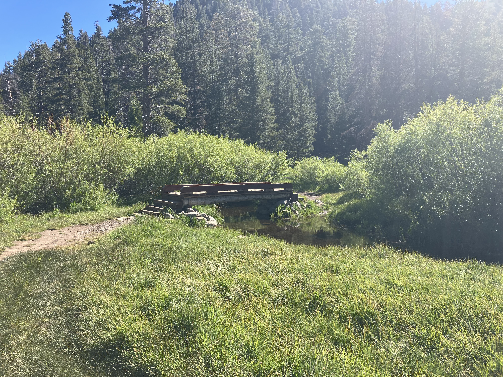

# SurelyTrail

**SurelyTrail** is a free trail discovery and navigation app for hikers. No subscriptions. No paywalled maps. Built to make outdoor exploration accessible to everyone. Powered by [OpenStreetMap](https://www.openstreetmap.org) data.

<p align="center">
  
</p>

## Features

SurelyTrail is the companion app for hikers who just want to find a trail and go:

- Detailed trail maps with paths that often don’t show up elsewhere, thanks to [OpenStreetMap](https://openstreetmap.org)
- Browse and explore hiking trails on an interactive map
- Search for trails near you or in a place you’re visiting
- Tap any trail for distance, difficulty, elevation gain, and estimated time
- Discover popular and famous routes without digging through forums
- Plan your next hike with clear trail info up front
- Works on **iOS**, **Android**, and the **web**
- Free and open — no ads, no subscription for core features

## Why SurelyTrail?

Most hiking apps bury useful features behind a subscription. SurelyTrail doesn’t.

Use it when you want to:

- Find a hike without creating an account or paying first
- See trails on the map instead of scrolling endless lists
- Get the basics — length, difficulty, elevation — before you leave
- Rely on open map data instead of locked-down proprietary trails
- Spend your time outside, not managing another paid membership

SurelyTrail is free from the usual barriers:

- No paywall on the map
- No subscription for trail discovery
- No ads in the way of finding your route
- No mandatory account just to look around
- Focused on hikers, not upselling Pro tiers

Hiking should be easy to access for everyone — casual walkers, weekend explorers, and lifelong outdoor enthusiasts alike.

**Give SurelyTrail a try!**

## Coming soon

- Custom route planning
- Live hike timer and personal hike history
- Trail ratings, reviews, and community contributions
- Broader coverage beyond the first regions

## Run it locally

```bash
git clone https://github.com/guichnicolas-collab/SurelyTrail.git
cd SurelyTrail
npm install && npm install --prefix frontend
cp .env.sample .env   # set MONGO_CONNECTION_STRING
npm run seed          # optional: load OSM trail data
npm start
```

## Contributing

Contributions welcome — code, bug reports, and trail ideas all help. Open an issue or pull request on [GitHub](https://github.com/guichnicolas-collab/SurelyTrail).

## License

See [LICENSE](LICENSE). Map data © [OpenStreetMap](https://www.openstreetmap.org/copyright) contributors.
